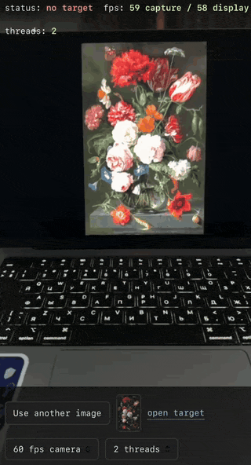
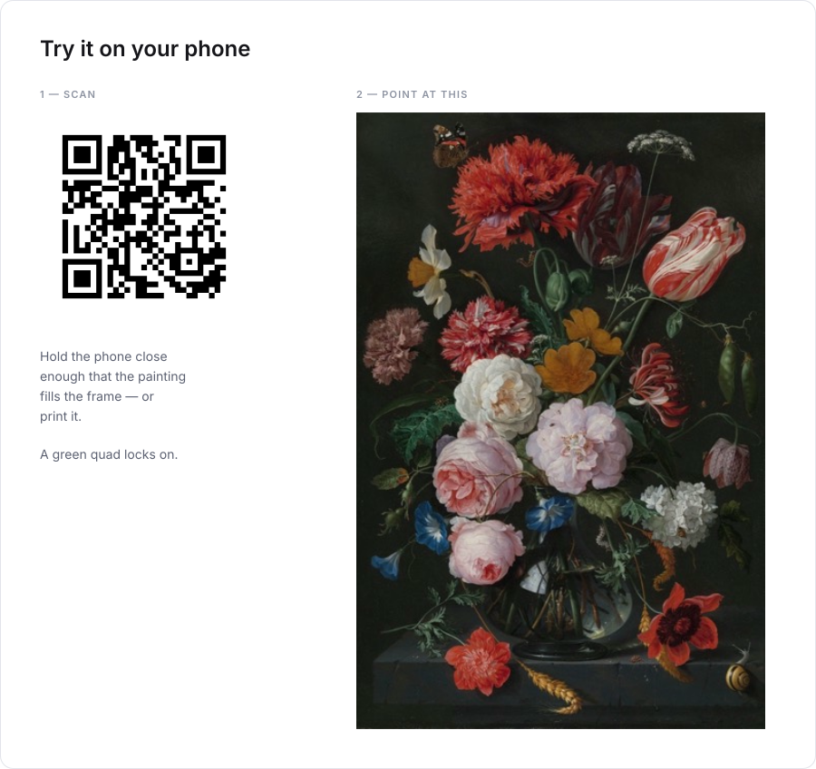
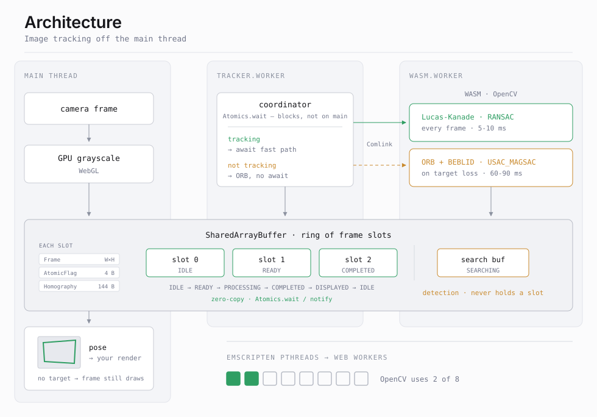

# Morpheus Tracker

Planar image target tracker for the browser. Give it a reference image; it
finds that image in a camera frame and returns a homography plus the four
target corners — enough to place AR content on it.

C++/WASM core, tracking entirely off the main thread. **60 fps on a modern
iPhone.**



## Try it

<picture>
  <source media="(prefers-color-scheme: dark)" srcset="docs/try-it-dark.svg"/>
  
</picture>

## How it works

Two modes, picked by whether the target is currently held:

- **Tracking** — pyramidal Lucas-Kanade optical flow over pre-selected
  Shi-Tomasi points, then RANSAC. Every frame, 5-10 ms.
- **Detection** — ORB keypoints with
  [BEBLID](https://docs.opencv.org/4.x/d7/d99/classcv_1_1xfeatures2d_1_1BEBLID.html)
  descriptors, brute-force matching, USAC_MAGSAC. Only when there is nothing
  to track, 60-90 ms — and it runs in its own buffer, so it never stalls the
  pipeline.

Drift is corrected periodically by warping the frame back into the template
plane. Homographies are rejected before they reach your scene if the
determinant, condition number or perspective distortion look degenerate.

## Architecture

<picture>
  <source media="(prefers-color-scheme: dark)" srcset="docs/architecture-dark.svg"/>
  
</picture>

Frames are written straight into shared linear memory — nothing is copied
between threads. Emscripten pthreads compile to Web Workers, which is why a
60-90 ms detection pass never stalls rendering.

OpenCV's `parallel_for_` runs on its pthreads backend, with the thread count
set at runtime.

## Usage

```ts
import {TrackingLoop} from '@morpheus/tracker'

const loop = new TrackingLoop({
  canvas: document.getElementById('view') as HTMLCanvasElement,
  drawDetectionQuad: true,
  onPose: (pose) => {
    // pose.H       — 3x3 homography, row-major, template → frame
    // pose.corners — [x0,y0, x1,y1, x2,y2, x3,y3] in frame pixels
    render(pose)
  },
})

await loop.init()                  // opens the camera, boots the workers
await loop.setTemplate(rgba, w, h) // RGBA, four bytes per pixel
await loop.start()
```

`setTemplate` wants **RGBA**, as `ImageData.data` gives it — grayscale is
converted in WASM. Pass grayscale yourself and it is read as RGBA, so the
tracker searches for garbage.

## Build

Needs [Conan](https://conan.io/) 2.x, CMake ≥ 3.15, a C++23 compiler and
Node ≥ 18. The Emscripten SDK comes in through Conan.

```bash
make wasm          # deps + build → js/src/wasm/   (first run builds OpenCV)
npm install
npm run dev        # https://localhost:5180
```

```bash
make test          # gtest: unit + integration
make benchmark     # POT-280 accuracy benchmark
npm run build      # static demo → demo/dist, about 3.4 MB
```

## Cross-origin isolation

`SharedArrayBuffer` is only available on a cross-origin isolated page, and the
tracker needs it — the WASM memory is shared and frames are handed over
through it. Serve the page with:

```
Cross-Origin-Opener-Policy: same-origin
Cross-Origin-Embedder-Policy: require-corp
```

## License

MIT. The bundled demo target is *Still Life with Flowers in a Glass Vase*
by Jan Davidsz. de Heem, Rijksmuseum
[SK-C-214](https://www.rijksmuseum.nl/en/collection/SK-C-214) — public
domain, see `demo/public/ATTRIBUTION.md`.
